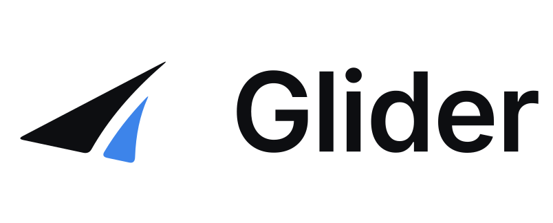
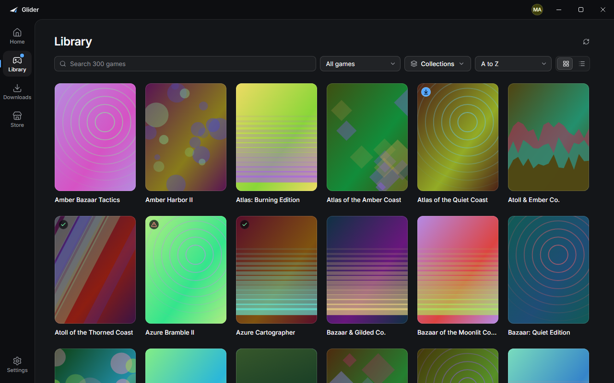
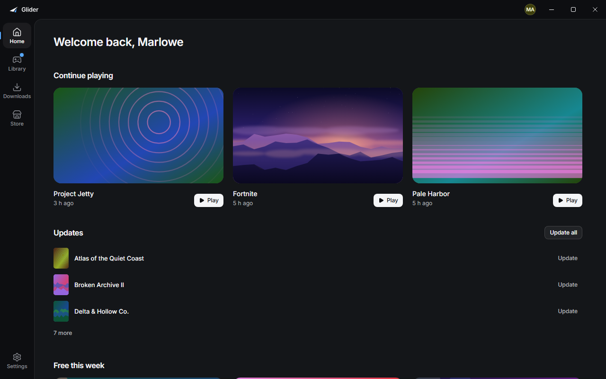
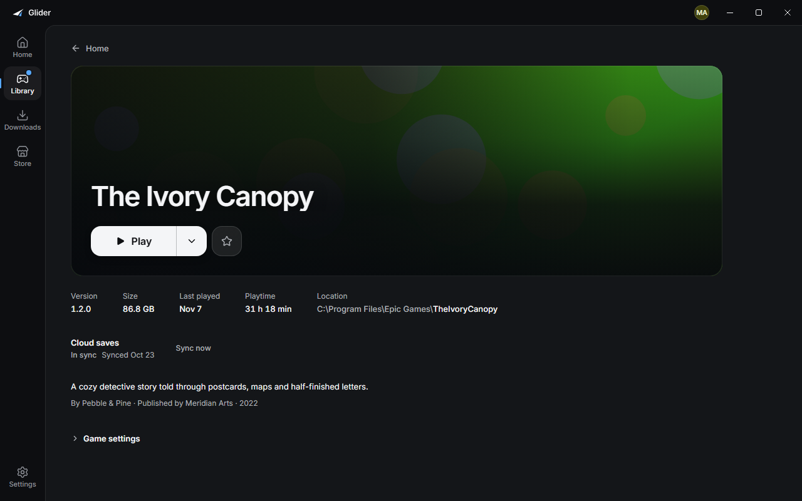
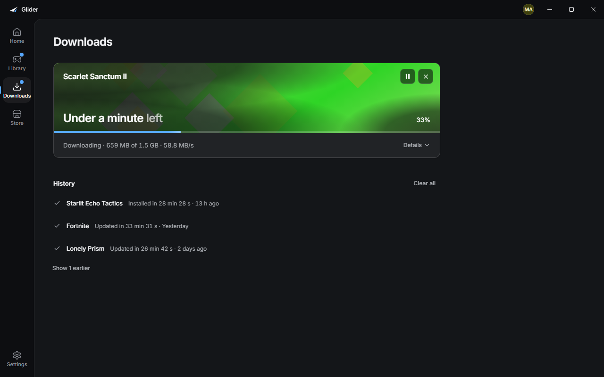
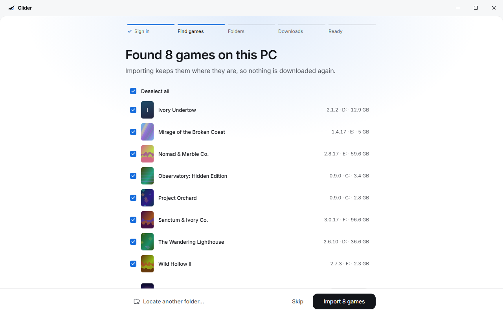

<div align="center">

<picture>
  <source media="(prefers-color-scheme: dark)" srcset="assets/brand/glider-wordmark.svg">
  
</picture>

### Your Epic games, without the weight.

A fast, quiet Windows launcher for your Epic Games library. Bring over the games you already have, with nothing
re-downloaded, then install, update and play without opening the Epic Games Launcher.

[](../../releases/latest)
[](#install)
[](LICENSE)

[**Download**](../../releases/latest) · [Features](#features) · [Install](#install) · [Build from source](#build-from-source)

<br>



</div>

## Why Glider

- **Light.** About a second from launch to a ready window. At idle the app itself uses around 3 MB of private memory,
  and in the tray its web view is suspended. Measurements are in [docs/perf.md](docs/perf.md).
- **Downloads that respect your PC.** Full, Balanced and Background modes change CPU, disk and memory priority while a
  download runs. Slow download servers are skipped automatically, and Glider tells you when your drive, not your
  connection, is the bottleneck.
- **Keeps what you have.** It finds the games the Epic Games Launcher installed on any drive and imports them in place.
  Both launchers can keep working on the same folders until you're ready to let the old one go.
- **Feels like Windows.** Mica, light and dark themes, Windows 11 scrollbars, a tray with per-game actions, Snap
  Layouts, and no ads.

<p align="center">
  
  
  
  
</p>

> [!NOTE]
> Glider is an unofficial, independent project. It is not affiliated with or endorsed by Epic Games. Fortnite and Epic
> Games are trademarks of Epic Games, Inc.

## Features

**Library.** Every game your account owns, installed or not, in a grid or a list, with search, filters, favorites,
hidden games and collections. It opens from a cache and refreshes in the background. **Home** shows what to continue,
pending updates and the free games of the week. Each game has its own page with one main button, DLC, and per-game
settings (launch arguments, executable, update policy). `Ctrl+K` opens the command palette; `Ctrl+1` to `Ctrl+5` switch
pages.

**Install, update, play.** Pick a folder with a real free-space check; update, verify, repair, move or uninstall. The
Downloads page shows live speed and disk-write readouts and the time left, with a queue you can reorder; downloads pause,
resume, and survive a restart. Set a speed limit, run at full speed when you're away, and choose what happens while you
play. Play starts the game directly, handling Easy Anti-Cheat setup, prerequisites, and the Ubisoft Connect or EA app
hand-off. Launching never waits behind a download.

**Cloud saves and overlay.** Saves sync before and after you play, with a conflict check that doesn't rely on file
times, a backup before every overwrite, and nothing blocking offline play. The Epic overlay (friends, achievements) can
be installed, switched on or off, and removed.

**Store and Windows.** The Epic Games Store opens in its own tab, framed like the rest of Glider, plus a *Free this
week* strip. Glider also gives you desktop and Start menu shortcuts per game, `glider://` links, optional
`com.epicgames.launcher://` handling, start with Windows, and a single instance.

<details>
<summary><b>Not planned</b></summary>

- **Buying inside Glider.** The Store tab is Epic's own web store; payment happens there.
- **Friends and chat** outside the Epic overlay.
- **Unreal Engine, Fab and Marketplace** content, and **mod stores**.
- **Replacing other launchers.** Ubisoft Connect and EA app games that Epic lists start through their own launcher.

</details>

## Install

1. Download **`Glider-win-Setup.exe`** from the [latest release](../../releases/latest) and run it. It installs for
   your user only (no admin) and fetches the WebView2 runtime if it's missing.
2. The installer isn't code-signed yet, so SmartScreen may say *"Windows protected your PC"*. Click **More info → Run
   anyway**.
3. **Sign in with Epic.** A login window opens and closes by itself once you're in.
4. **Bring your games over.** Glider lists the games the Epic Games Launcher installed on any drive. *Import* adds them
   without downloading; *Locate another folder…* adds one the scan missed. You can import more later from Settings →
   Epic Games Launcher.
5. Choose where new games install and a download mode (Balanced is the default), then press **Play**. A game's first
   launch with Easy Anti-Cheat may show a Windows prompt; accept it.

**Updates.** Glider checks this repository's releases in the background and downloads new versions quietly. When one
is ready, a notice offers **Restart**; otherwise it installs the next time you quit Glider.

Your data (sign-in, library cache, settings, save backups) lives in `%LocalAppData%\GliderData`, apart from the app, so
uninstalling Glider keeps it. Delete that folder to remove everything.

## Known limitations

- The **speed limit is approximate below about 5–10 MB/s**; the Downloads card shows the measured rate.
- **Windows 10** hasn't been tested on real hardware yet.
- Some flows haven't been confirmed against a real Epic account yet: Store checkout, cloud-save conflicts and the Epic
  Games Launcher write-back. The checklist is in [docs/testing.md](docs/testing.md).

<details>
<summary><b>Troubleshooting</b></summary>

| Problem | What to do |
|---|---|
| Where are the logs? | `%LocalAppData%\GliderData\logs\`. Settings → Advanced has a log viewer and **Copy logs** for bug reports (tokens are never included). |
| Sign-in fails or the window closes | Try again. If it keeps failing, copy the diagnostic logs from the "Sign-in was canceled" notice. |
| "Your session expired" | Click **Sign in** again. |
| A download is slow | The Downloads card says why. If it names your drive, its write speed is the limit; if it names a download server, Glider switches servers by itself. Also check Settings → Downloads for a speed limit or Background mode. Details: [docs/download-perf.md](docs/download-perf.md). |
| "Game files need repair" | Game page → **Repair**; only broken files are downloaded. |
| A download stalls | Progress is kept: press **Resume**. |
| Using the Epic Games Launcher too | Glider waits while it updates or verifies a game. With *Keep in sync* on (Settings → Epic Games Launcher), Glider updates its record after each update or move, so nothing re-downloads. See [docs/egl.md](docs/egl.md). |
| Windows Security blocks Legendary | Glider says so and opens Windows Security; allow it in Protection history (a false positive). |
| Anti-cheat error on launch | Press **Play** again and accept the Windows prompt. |
| Something else | Settings → Advanced → **Copy logs**, then [open an issue](../../issues). |

</details>

## How it works

A thin WPF host renders a React UI in WebView2 from local files and talks to `Glider.Core` over a typed JSON-RPC bridge.
Core drives a bundled, hash-pinned build of [Legendary](https://github.com/legendary-gl/legendary) to talk to Epic.

```
 Glider.App (WPF, WebView2)  ── window, tray, sign-in, Store view, links, single instance
        │  https://app.glider/  → frontend (React 19, TypeScript, Vite, Tailwind)
        │  typed RPC · a small state snapshot · library deltas · 10 Hz progress
 Glider.Core (no UI)  ── library, jobs, games, EGL import, cloud saves, overlay, store
        │  job lanes: writer · metadata · saves · launch (never queued) · read
 legendary.exe  ── Glider's patched Legendary 0.21.1 (0.21.1-glider.3), SHA-256 pinned
```

All logic lives in Core, which is cross-platform and unit-tested; the host is only Windows glue, and the frontend runs
in a browser against a mock backend that implements the same contract. More in [ARCHITECTURE.md](ARCHITECTURE.md),
[DECISIONS.md](DECISIONS.md) and [docs/](docs).

## Build from source

Requirements: Windows 10/11, the [.NET 10 SDK](https://dotnet.microsoft.com/download) (see `global.json`), Node 24+ and
[pnpm](https://pnpm.io) 10.

```powershell
# Everything: contract check, frontend, Legendary (SHA-256 verified), self-contained publish
pwsh build/build.ps1 -Version 0.2.5            # add -Pack for the Velopack installer in artifacts/releases

# Checks
dotnet build Glider.slnx -c Release -warnaserror
dotnet test --project tests/Glider.Core.Tests -c Release
cd frontend; pnpm install; pnpm lint; pnpm typecheck; pnpm test

# The UI in a browser against the mock backend (?scenario=eglDetected, downloading, …)
cd frontend; pnpm dev
```

<details>
<summary><b>More for contributors</b></summary>

- **Contract.** C# records in `src/Glider.Core/Contracts` are the source of truth. After changing them, regenerate the
  TypeScript types with `dotnet run --project tools/Glider.ContractGen`; CI checks they're in sync.
- **Tests.** The Core suite (xUnit v3) runs against `tests/FakeLegendary`, a scriptable stand-in for `legendary.exe`,
  with no network, Epic account or GUI, and timing logic on a manual clock. A second suite runs Core against the real
  pinned `legendary.exe`, hermetically (`GLIDER_REAL_LEGENDARY=1` locally, always in CI). What's covered, and the manual
  checklist for a real account, are in [docs/testing.md](docs/testing.md).
- **Screenshots** come from the mock backend: `pnpm screenshots:readme` in `frontend/`.
- **Releases.** See [build/README.md](build/README.md). Pushing a `v*` tag builds, tests and publishes the installer.

</details>

## License and credits

Glider's code is released under the [MIT license](LICENSE).

- **[Legendary](https://github.com/legendary-gl/legendary)** (GPLv3) does the Epic protocol work. Glider bundles it as a
  separate executable with a small patch (bounded retries, download server failover, live speed changes, clearer
  progress). The patch, license and source offer ship with the app and live in `tools/legendary-fork/`.
- **[Heroic Games Launcher](https://github.com/Heroic-Games-Launcher/HeroicGamesLauncher)** was a research reference for
  how Epic's clients behave ([notes](docs/research/heroic-v0.2.md)).
- **[Inter](https://rsms.me/inter/)** (SIL Open Font License) is the UI font.
