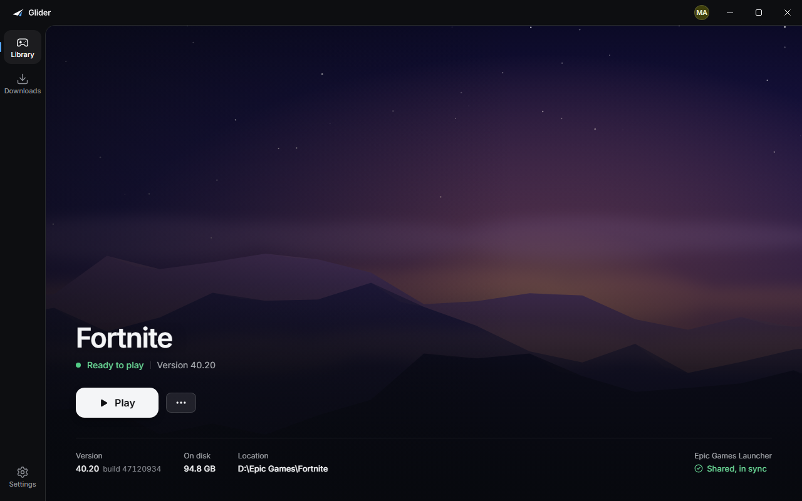
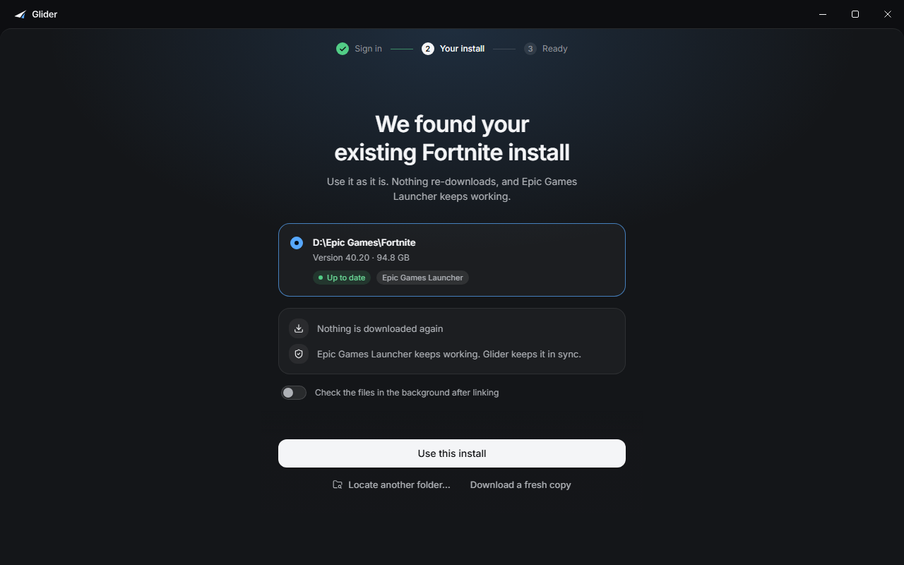
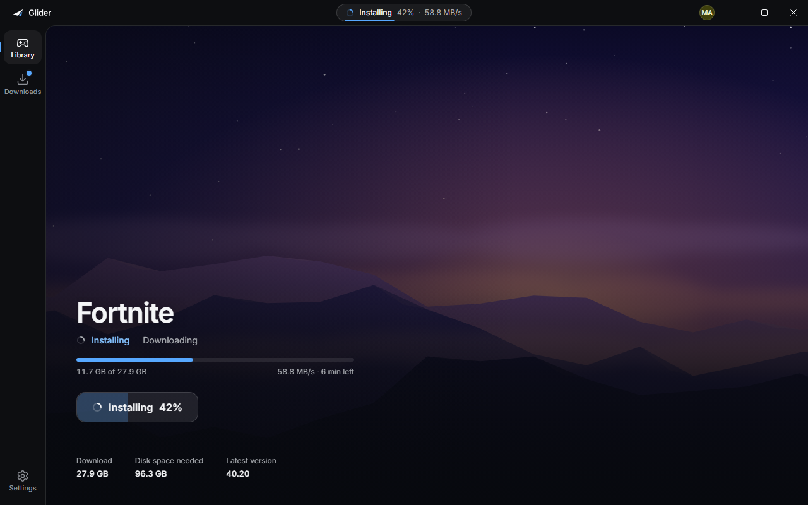
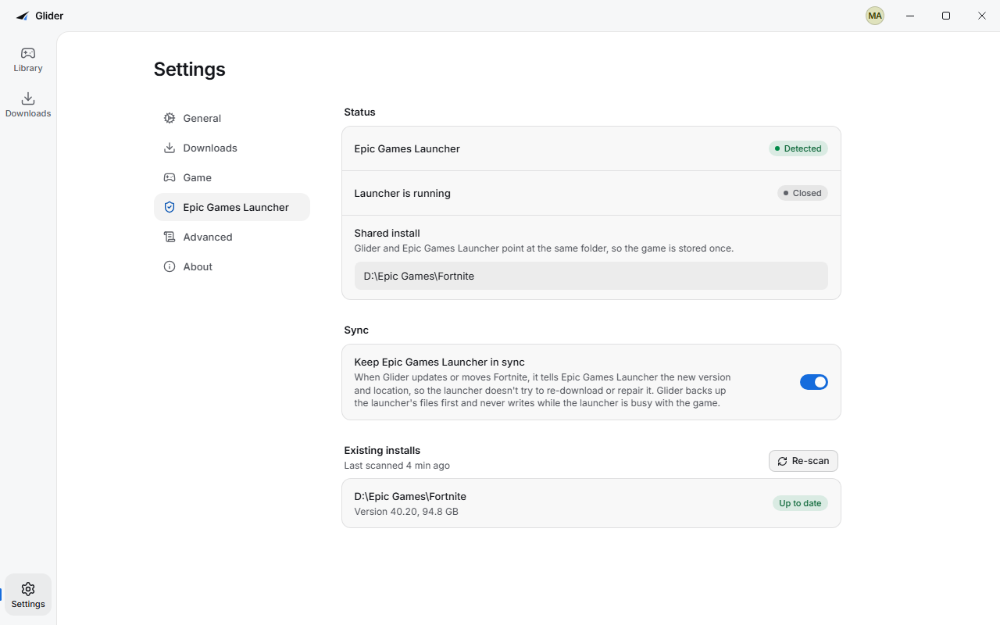

# Glider

A fast, quiet Windows launcher for Fortnite that fully replaces the Epic Games Launcher. Sign in, install
(or adopt your existing install with zero re-download), update, verify/repair and play, without opening
the Epic Games Launcher.

<p>
  
  
  
  
</p>

> Glider is an unofficial, independent project. It is not affiliated with or endorsed by Epic Games.
> Fortnite is a trademark of Epic Games, Inc.

## Features

- **Sign in with Epic** in a built-in login window; the code is captured automatically.
- **Install** with a location picker and a real free-space check, or **adopt an existing install** made by
  the Epic Games Launcher (EGL): no re-download, and EGL keeps working on the same folder.
- **Downloads**: live %, downloaded/total, speed, ETA, disk-write speed and a throughput sparkline;
  pause/resume/cancel; resumes after a restart or crash. Workers and memory auto-tuned to your machine.
- **Updates**: checked at startup and periodically, with a badge, tray notification and optional auto-update when idle.
- **Play**: big Play button, Easy Anti-Cheat setup on first launch (skipped if EGL already installed it),
  game state tracking (launching → running → closed), minimize to tray while playing, custom launch args.
- **Maintenance**: verify/repair, move, uninstall ("Remove from Glider only" or delete files), open folder.
- **Native feel**: Windows 11 Mica, Snap Layouts, tray, single instance, start with Windows, dark/light themes.

## Install and run

1. Download `Glider-win-Setup.exe` from the [latest release](../../releases/latest) and run it.
2. **SmartScreen**: the build isn't code-signed yet, so Windows may say "Windows protected your PC".
   Click **More info → Run anyway**. Glider installs per-user (no admin) to `%LocalAppData%\Glider`
   and creates a Start-menu shortcut. Your data (Epic sign-in, library, settings, save and EGL backups, logs) lives separately in
   `%LocalAppData%\GliderData`, so uninstalling Glider keeps it; delete that folder to remove it too. Data from an older Glider is
   moved there automatically at the first start (a `data-moved-to.txt` note is left behind). If the WebView2 runtime is missing (rare on Windows 10/11), the
   installer downloads it.
3. **First run**: Glider asks you to **Sign in with Epic**. A login window opens and closes by itself once you're signed in.
4. Then either:
   - **Fresh install**: pick a drive/folder (Glider shows download and disk size against free space), then **Install**.
   - **Existing install**: Glider detects Fortnite installed by EGL and shows *"We found your existing Fortnite
     install"*. Click **Use this install**. Nothing is downloaded. You can also **Locate another folder…**.
5. Press **Play**. The first launch may show a Windows (UAC) prompt to install Easy Anti-Cheat; accept it.

**Logs**: `%LocalAppData%\GliderData\logs\` (`glider-YYYYMMDD.log` for the core, `host-YYYYMMDD.log` for the window).
Settings → Advanced has a log viewer and **Copy logs** for bug reports (no tokens are included).

## Switching from the Epic Games Launcher

- On startup Glider reads EGL's install manifests (`%ProgramData%\Epic\EpicGamesLauncher\Data\Manifests\*.item`
  and `LauncherInstalled.dat`), on any drive. Stale entries (moved/deleted folders) are shown but disabled.
- **Adoption is a one-time import** into Glider's own isolated data (`%LocalAppData%\GliderData\legendary`).
  Nothing re-downloads. If EGL's version matches the latest, no verify is needed; otherwise a background verify runs.
- **EGL keeps working.** Glider never deletes, moves or edits EGL files, with one opt-in exception:
  **"Keep Epic Games Launcher in sync"** (Settings → Epic Games Launcher, on by default when EGL is detected).
  After Glider updates the game, it writes the new version back into EGL's manifest exactly like Legendary's
  EGL export does, so EGL doesn't ask to re-download or repair. Every EGL file is backed up first
  (`%LocalAppData%\GliderData\backups\egl`) and written atomically.
- If EGL updates the game, Glider notices at startup and silently refreshes its record. It never re-downloads.
- While EGL is updating or verifying Fortnite, Glider waits ("Epic Games Launcher is updating Fortnite, so
  Glider will wait") and continues automatically. Launching while EGL is merely open is fine.
- Uninstalling an adopted install defaults to **Remove from Glider only**, which leaves files and EGL untouched.
- Glider never uses EGL's sign-in (importing it would sign EGL out).

## Build from source

Requirements: Windows 10/11, [.NET SDK 10](https://dotnet.microsoft.com/download) (see `global.json`),
Node 24+ and [pnpm](https://pnpm.io) 10.

```powershell
# Everything: contract check, frontend build, Legendary fetch (SHA-256 verified), self-contained publish
pwsh build/build.ps1 -Version 0.1.0          # add -Pack to produce the Velopack installer in artifacts/releases

# Inner loop
dotnet build Glider.slnx
dotnet test --project tests/Glider.Core.Tests
cd frontend; pnpm install; pnpm dev          # UI in a browser against the mock backend (?scenario=eglDetected, downloading, …)
pnpm lint; pnpm typecheck; pnpm test; pnpm screenshots
```

After changing the IPC contract in `src/Glider.Core/Contracts`, regenerate the TypeScript types:
`dotnet run --project tools/Glider.ContractGen`. See [build/README.md](build/README.md) for releases.

## Architecture

A thin WPF host (`src/Glider.App`) renders a React UI in WebView2 from local files (`https://app.glider/`) and
talks to `Glider.Core` over a typed JSON-RPC bridge whose TypeScript types are generated from the C# contract.
Core drives a bundled, hash-pinned [Legendary](https://github.com/legendary-gl/legendary) 0.21.1 as the Epic
protocol engine, with a persistent job queue, an EGL coexistence module and a service layer.
Details: [ARCHITECTURE.md](ARCHITECTURE.md), decisions: [DECISIONS.md](DECISIONS.md), EGL: [docs/egl.md](docs/egl.md).

## Troubleshooting

| Problem | Fix |
|---|---|
| "Your session expired" | Click **Sign in** again. |
| "Not enough disk space" | Free space or pick another drive; the message shows exactly how much is needed. |
| Download stalls / network error | Progress is kept; press **Resume**. Try another CDN in Settings → Downloads. |
| "Game files need repair" | Library → ⋯ → **Verify & repair** (downloads only what's broken). |
| Anti-cheat error on launch | Retry **Play** and accept the Windows prompt. |
| Glider waits on "Epic Games Launcher is updating" | Let EGL finish (or close it); Glider continues by itself. |
| Something else | Settings → Advanced → **Copy logs** and open an issue. |

## License

Glider's code is released under the MIT license. Legendary is bundled unmodified as a separate executable under
GPLv3 (license and source link in Settings → About). Inter is under the SIL Open Font License.
