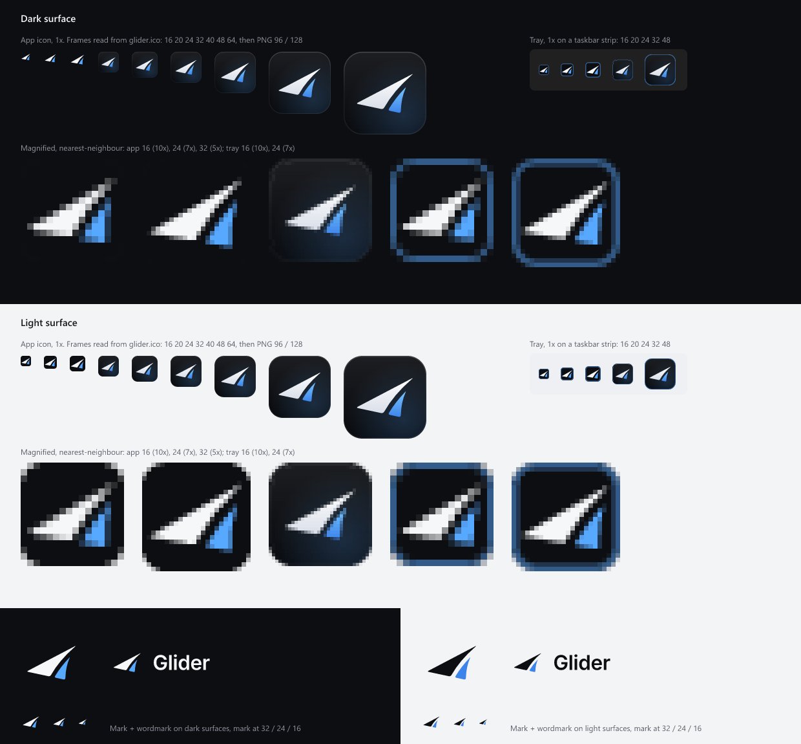

# Glider brand assets

The logo, app icon and tray icon for Glider. Everything in this folder is
generated: edit the geometry in [`build/icons/lib`](../../build/icons/lib) and
re-run the generator (see [Regenerate](#regenerate)). Don't hand-edit the SVGs.



## Concept

A glider is a wing that gets its speed for free. The mark is two nested swept
wings, climbing:

- **The wing** (paper white): a straight leading edge, a concave trailing edge
  (the lift curve) and a flat root.
- **The flap** (glide blue): a crescent whose leading edge is the wing's
  trailing curve, offset by a constant gap. The blue sliver is the air being
  turned over the wing, and together the two read as one slotted wing.

It is two fills, no strokes, so nothing thins out when it's small. The whole
mark leans 12 degrees into a climb, which also makes the silhouette wider than
tall and keeps it from reading as a sail or a send arrow. It doesn't borrow
from any game, publisher or launcher: no llama, bus, shield or letterform.

## Files

| File | Use |
| --- | --- |
| `glider-mark.svg` | Symbol for **dark** surfaces (white wing, blue flap). 64 x 64 viewBox |
| `glider-mark-onlight.svg` | Symbol for **light** surfaces (graphite wing, deeper blue flap) |
| `glider-mark-mono.svg` | One colour, both shapes use `currentColor`. For favicons, embossing, watermarks, UI glyphs |
| `glider-wordmark.svg` | Mark + "Glider" for dark surfaces. Text is outlined, no font needed |
| `glider-wordmark-onlight.svg` | Same, for light surfaces |
| `glider-app-icon.svg` | Windows app icon: mark on a rounded graphite tile (256 x 256) |
| `glider-icon-16.svg` | Small-size drawing of the app icon, used for 16, 20 and 24 px |
| `glider-tray.svg`, `glider-tray-16.svg` | Tray variant: same tile plus a glide-blue rim |
| `glider.ico` | 16, 20, 24, 32, 40, 48, 64, 256. Sizes under 64 are 32-bit BMP, 64+ are PNG |
| `tray.ico` | 16, 20, 24, 32, 48 |
| `png/glider-{16,20,24,32,40,48,64,96,128,256,512}.png` | Rasters of the app icon |
| `preview.png` | Contact sheet of every size on dark and light |

## Small sizes

The full app icon has a soft glow and a gradient rim that turn to mud below 32
px, and its blue flap is a hairline there. For 16, 20 and 24 px the generator
uses `glider-icon-16.svg` instead: flat fills, a larger mark, a wider gap
between wing and flap, a thicker flap, and a 10 degree bank (not 12) so the
wing's top edge falls on fewer pixel rows. Sizes 32 and up use the full icon.

The tray icon has to sit on both dark and light taskbars. The graphite tile
carries it on light, and a 1 px glide-blue rim at 50% opacity keeps the tile's
edge visible on a dark taskbar (#202020), where graphite alone disappears.

## Construction

All shapes live on a 64-unit grid. See [`lib/mark.mjs`](../../build/icons/lib/mark.mjs).

- **Live area:** 52 x 52 of 64 (81%), centred on the mark's bounding box. The
  app icon scales that to 45/64 of the 256 tile (70%).
- **Wing:** three anchors (root, tip, trailing-edge end) plus one quadratic
  control point for the trailing curve. Fillets: 3 at the tip, 2 elsewhere.
- **Flap:** the wing's trailing curve translated 5.5 units along its normal.
  It starts 30% down the curve, runs to the root line, and is 15 units wide at
  the root. Its own trailing edge curves the same way (belly 4). Fillets: 1.6 at
  the tip, 2 elsewhere.
- **Bank:** 12 degrees (10 in the small drawing).
- **Tile:** 256 x 256, corner radius 58 (about 22.7%), graphite gradient from
  `#1c1e22` to `#07080b`, a 20% glide glow at the lower right, and a 3-unit
  white rim fading from 18% to 4%.
- **Wordmark:** Inter SemiBold at 40 units, tracking -1.5%, kerning on. The
  mark is 1.9 x cap height and the gap is 0.55 x cap height.

## Clear space and minimum size

- **Clear space:** keep at least a quarter of the mark's width clear on every
  side (16 units on the 64 grid, 4 px for a 16 px mark). For the wordmark use
  the cap height of the "G".
- **Minimum size:** 16 px for the app icon, 24 px for the bare mark. At 16 px
  the bare mark's flap is a speck, so use the tile version there.

## Colour

Authored in OKLCH, shipped as sRGB hex (gamut-clipped). The generator does the
conversion in [`lib/color.mjs`](../../build/icons/lib/color.mjs).

| Name | OKLCH | Hex | Use |
| --- | --- | --- | --- |
| Graphite | `oklch(0.165 0.006 265)` | `#0d0e11` | Tile base, wing on light |
| Graphite high | `oklch(0.235 0.008 265)` | `#1c1e22` | Tile gradient, top |
| Graphite low | `oklch(0.135 0.006 265)` | `#07080b` | Tile gradient, bottom |
| Paper | `oklch(0.975 0.003 265)` | `#f6f7f9` | Wing on dark |
| Glide blue | `oklch(0.72 0.15 252)` | `#57a8ff` | Flap, accent |
| Glide high | `oklch(0.80 0.12 245)` | `#78c6ff` | Flap gradient, top |
| Glide low | `oklch(0.62 0.17 258)` | `#3d84ea` | Flap on light, flap gradient bottom |

Contrast: graphite on paper is 18:1 and glide blue on graphite is 7.8:1. Glide
blue on white is only 2.5:1, so it is fine for a flap but not for text. Glide
low on white is 3.7:1: use it for large graphics and UI, not small body text.

## Do and don't

Do:

- Use `glider-mark.svg` on dark and `glider-mark-onlight.svg` on light.
- Use `glider-mark-mono.svg` where only one colour is possible, and set the
  colour with CSS `color`.
- Use the tile (`glider-app-icon.svg`, `glider.ico`) wherever the OS draws the
  icon, and the tray `.ico` for the notification area.

Don't:

- Stroke, outline, glow or drop-shadow the mark.
- Recolour the flap to anything but glide blue, or the wing to anything but
  paper or graphite.
- Rotate, mirror, stretch or separate the two shapes. The gap is part of the
  mark.
- Put the white mark on a light surface or the graphite mark on a dark one.
- Put the full-colour tile on a graphite background without space around it:
  the tile edge disappears.
- Set the name in another typeface. Use `glider-wordmark.svg`.
- Add any other shape (circles, shields, letters) to the mark.

## Regenerate

Needs Node 20+ and pnpm.

```sh
cd build/icons
pnpm install
pnpm build        # generate.mjs (SVG, PNG, ICO) then preview.mjs (contact sheet)
```

`pnpm generate` writes the assets only; `pnpm preview` redraws `preview.png`
from what's on disk. `preview.mjs` uses system fonts for its labels, so label
text can differ slightly between machines. The logo files never use fonts.

Outputs are deterministic. If a rebuild changes a committed file, the geometry
or the palette changed.

The wordmark outlines come from Inter (SIL OFL 1.1) via `@fontsource/inter`.
