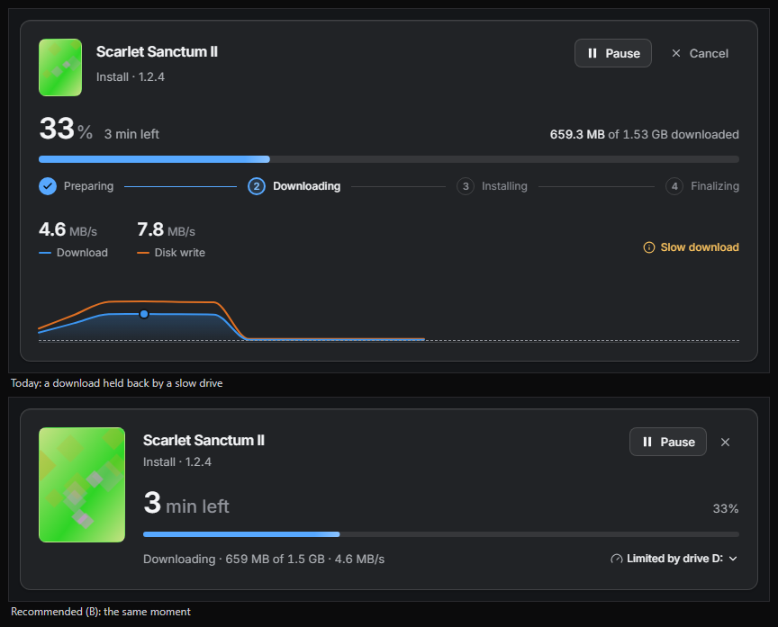
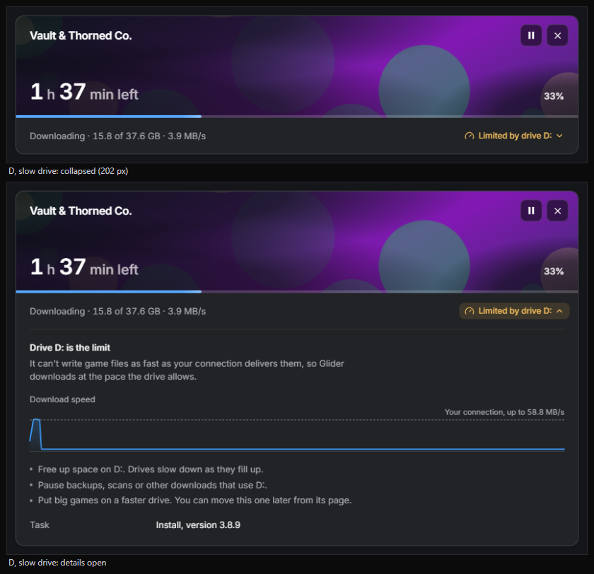
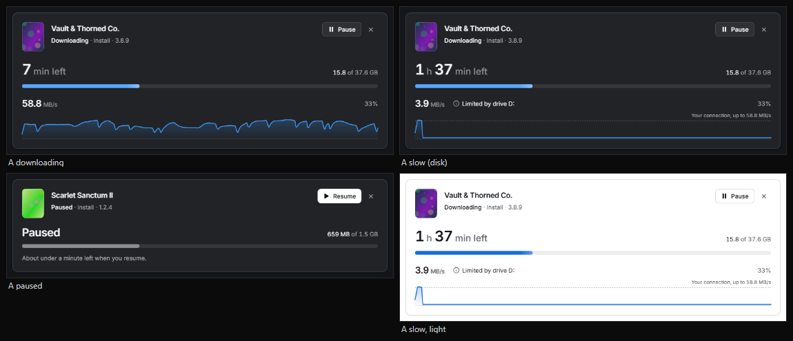
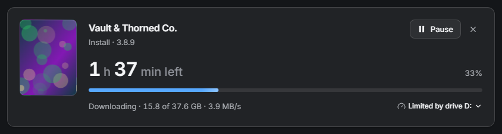
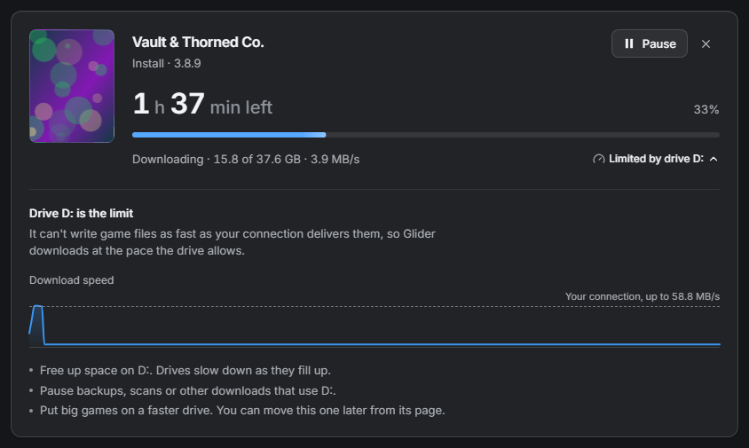
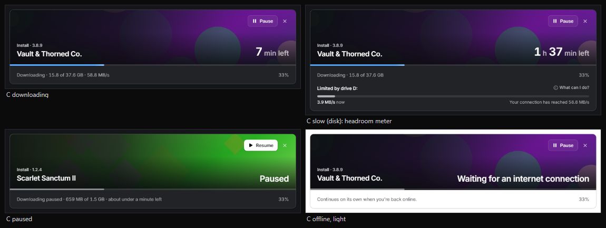
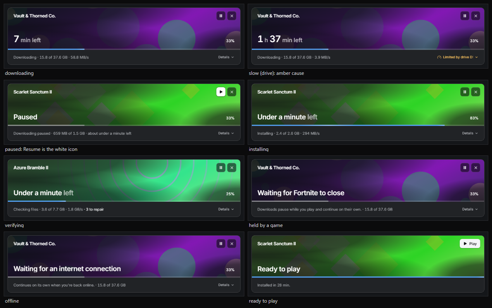

# The active download card: critique and redesign proposal

The owner's brief: "I don't really like the current one that much and I'm open to suggestions." This is a review of the
card at the tip of `v0.2` (`1dd1a72`), three directions, and a full spec for the recommended one. Earlier owner
suggestions (`DECISIONS.md`, `docs/design-critique-v0.2.md` P0-1) were read for history only, not treated as constraints.

**Method.** I shot the live card with the production build and the mock backend in 20 states × dark/light × 1280×800 and
960×600, plus filmstrips of pause, resume and a phase change (`frontend/e2e/mockups/shoot-current.mjs`, `film-card.mjs`).
The mockups are real React components rendered inside the real app (the mock backend's live data, the app's tokens,
fonts and ui kit). `frontend/e2e/mockups/vite.config.mjs` swaps `Downloads.tsx`'s card import for a switcher (`?card=a|b|c`).
No product code changed. Screenshots: [`screenshots/download-card-redesign/`](screenshots/download-card-redesign/).
Mock values (sizes, speeds, a 58.8 MB/s connection) are the mock's. The slow-drive case is forced with `?bottleneck=disk`.

## Verdict

The card is clean and honest per phase. But it answers the wrong question first, and it's at its worst in the case that
matters most on the owner's PC.

The biggest things on it are the percentage (32 px) and two live speeds (20 px each). Time left, the thing a person waits
on, is 14 px muted. The cause of a slow download, the only thing that explains a 40-minute wait, is a 12 px amber label in
the bottom-right corner. It says "Slow download", a verdict that doesn't name the cause. Below that sit a four-step wizard
stepper, a second speed (disk writes) that contradicts the explanation, and an auto-scaled chart that can't show slowness
because every flat line fills it the same. The card is 380 px tall. At 960×600 it fills 68 % of the content area, and
Up next falls below the fold.

**Recommendation: Direction B, "Cover and one line".** Time left leads. One whole-job bar never resets. One line under the
bar says the current step, its bytes and its speed, and ends in a disclosure labelled with the cause ("Limited by drive
D:"). Behind the disclosure: why it's limited, a chart drawn against the connection's ceiling, and what to do. 202 px tall.
Every waiting state, including the new "Waiting for Fortnite to close" and "Waiting for an internet connection", reads
from the same slot.



**Owner follow-up:** "I really like B's philosophy, but C looks better." **Direction D, B×C (§7)** keeps B's information
model and behaviour in C's look: the game's wide art as a band, time left over it, and the bar on its edge. It's now the
proposal; §5 stays its behavioural spec, and §7 lists only what changes.



---

## 1. What the card is for

What a person wants from it, in order, over a download that on this PC typically runs 40 minutes or more:

1. **When can I play?** Time left, for the whole job.
2. **Is it working?** Something visibly alive, and a plain word for any state that isn't progress (paused, waiting).
3. **Why is it slow, and can I do anything?** The cause in a few words, with the full answer one click away.
4. **How far along?** Bar and one number.
5. **Control.** Pause/Resume, Cancel.

Speed is not on that list as a goal. It's evidence for 2 and 3. Nobody acts on 58.8 vs 61.2 MB/s.

## 2. The current card

Shots: `01-current-page-dark.png`, `02-current-960-dark.png`, `03-current-slow-disk-dark.png`, `04-current-slow-dialog-dark.png`,
`05`–`11`.

### What works

- **Phase honesty.** A verify never shows a download speed. Installing shows disk writes. The bytes name their unit
  ("downloaded", "written", "checked", "copied"). `state/transfer.ts` is a good single source.
- **Restraint.** One accent, graphite surfaces, tabular figures, no card-in-card. It already reads better than Steam's page.
- **The ETA is stable.** Core's countdown smoother plus bucketed copy ("Under a minute", "7 min") never jitters.
- **The slow-drive dialog is the best content on the page:** measured numbers and three concrete things to do
  (`04-current-slow-dialog-dark.png`). It's just two clicks deep behind a 12 px label.
- **User choices aren't treated as faults.** Speed limit and Background mode read as muted labels, not amber.
- **Cost model.** The chart is near-free (one render, compositor glide), figures update at 2 Hz, and the sheen stops when the window isn't focused.
- **Pause doesn't change the card's height**, and Resume becomes the primary button.

### What doesn't

**Hierarchy is inverted relative to the questions.** Type size by element: percentage 32 px > live speeds 20 px (×2) > title
16 px > time left 14 px muted > bytes 13 px > cause 12 px. The two speeds out-shout the time left. The cause, the most
useful sentence on a slow PC, is the smallest thing on the card.

**Element by element:**

| Element | What it tells the player | Verdict |
|---|---|---|
| Art 48×64, title, "Install · 1.2.4" | which game, install or update | Keep. The art is too small to give the page a focal point. |
| `33 %` (32 px) | how far, whole job | Demote. It's precise but not the question. |
| `Under a minute left` (14 px muted) | when | Promote. It's the main answer. |
| `659.3 MB of 1.53 GB downloaded` | how far, **this phase only** | **Contradicts the 33 %** (659 MB of 1.53 GB is 42 %): Core's percent is whole-job (download+install mapped to 0–90 %, then verify 90–98 %), the bytes are the download step. Two progress numbers that disagree on the same row. |
| Bar 8 px + sheen + glow | how far | Keep. The sheen is the most persistent motion on screen for 40 minutes. |
| Stepper (Preparing ✓ · Downloading · Installing · Finalizing) | which step | A full-width numbered wizard for steps nobody drives. "Preparing ✓" is always done by the time you look. "Finalizing" lasts seconds. On a real install Core plans **five** steps (it adds Verifying, `JobPlan.Phases`), so the real one is busier than the mock's. Its lit step *is* the state label, which the code hides to avoid saying it twice. For verify jobs it announces "Repairing" before anything is known to be broken. |
| `58.8 MB/s Download` (20 px) | speed | Evidence, not a goal. It's typeset as a headline and flickers at 2 Hz. |
| `96.8 MB/s Disk write` (20 px) | drive speed | **Confusing.** Writes are unpacked data, so they run 1.5–2× the download. On the slow drive the card reads Download 4.6, Disk write 7.8, "Slow download": the drive looks faster than the download it's blamed for. |
| Chart 80 px, auto-scaled, no axis | speed over time | **Can't show slow.** A flat line at 6.5 MB/s fills the plot exactly like a flat line at 60 MB/s. On the owner's PC it's a flat line for 40 minutes. The average label is a third speed figure. The peak dot is decoration. The first seconds show "Collecting speed data…" in an empty box (`07`). It's a tab stop on every visit. |
| `Slow download` amber 12 px, bottom right | why | Names a verdict, not the cause. It's amber for the whole download on a disk-bound PC, for something the player can't fix now, which is alarm fatigue. The proof (the connection could do ~34 MB/s) isn't on the card, only in the dialog. |
| `Cancel` labelled ghost button | control | Equal weight to Pause for a rare, destructive action that already confirms. |

**Phases (`06-current-phases-dark.png`):**
- **Installing:** Core sends **no ETA** while installing (`JobProgressTracker.Groups`), so the time slot switches to
  "0:13 elapsed". On this PC, with a 1 GiB cache draining at 6.5 MB/s, that's up to nearly 3 minutes when the countdown
  disappears right after it said "3 min left". The download ETA never counted that tail. The mock shows a value here, so the
  mock hides this.
- **Verifying:** no meta line, so the header is a lone title. `1.8 GB/s Reading` is a 20 px number nobody needs.
  "3 damaged so far" in amber alarms about something Glider will fix on its own.
- **Phase change (`11-current-film-phase.png`):** four things swap in one frame. The readouts drop from two to one. The bytes'
  denominator jumps (1.53 GB downloaded → 2.57 GB written). The chart re-scales (58 → 294 MB/s, so the whole history
  flattens to the floor). The stepper advances. Then the card vanishes into History with no "ready" moment on this page.

**Pause (`10-current-film-pause.png`, `05`):** six elements change in one frame. The bar turns a desaturated tan that looks
muddy in both themes. "Under a minute left" becomes "0:12 elapsed" (elapsed answers nothing while paused). The live speeds
become averages, *different numbers* in the same place (98.8 → 85.3), which reads like a glitch. The chart dims.

**Waiting and holds:**
- **Held because a game is running** (`08-current-held-by-game-dark.png`): the card collapses to a header with a grey dot
  and "Queued". No reason, nothing that says it continues on its own. Up next rows don't say either.
- **Offline** (`09-current-offline-dark.png`): today the job fails into "Couldn't finish" with a red toast. Core will
  instead hold it ("Waiting for an internet connection", resumes on reconnect), and the card has no design for that.
- **Waiting for EGL** (`06`, last tile): the one waiting state with a sentence, but it's amber and still shows elapsed time and averages.

**Over 40 minutes.** What moves: two 20 px speeds flicker, the sheen sweeps every 2–3 s, the chart glides a flat line.
What matters: the time left changes once a minute in muted 14 px, and the amber label never changes. The motion is on the
least important things.

**Density.** 380 px for every byte-moving phase at both window sizes. The lower half (readouts and chart, ~170 px) has the
least decision value. At 960×600 the card ends at y = 513 of 600 (`02-current-960-dark.png`).

**Accessibility.** Good: a polite live region at 10 % steps and phase changes, stepper states for screen readers, a labelled
bar. Weak: the time-left tooltip (elapsed) isn't reachable by keyboard, the chart is an always-present tab stop, the
percent is `aria-hidden` while the bar's accessible value doesn't include time left, and amber 12 px text carries the
key explanation.

## 3. What other apps teach

- **Windows file copy ("More details").** The Windows-native precedent for a throughput graph: hidden by default,
  one click to reveal, title says the percent. **Steal:** the chart lives behind a disclosure.
- **Windows Update / Delivery Optimization.** "Downloading – 45 %", no speeds; activity graphs live on a separate page.
  **Steal:** calm, one status phrase. **Avoid:** hiding why it's slow.
- **Chrome downloads.** One grey line: "6.8 MB/s – 15.8 of 37.6 GB, 12 min left". **Steal:** one line of figures, unit once.
- **Steam.** Game art beside the bar, time remaining big, network and disk graph. **Steal:** art as the anchor, time big.
  **Avoid:** the graph and stats wall as the default view, and disk-usage numbers beside network numbers.
- **Xbox app (PC).** Box art, title, thin bar, "x of y GB · speed · time left", Pause and an overflow. **Steal:**
  compactness, icon-weight Cancel. **Avoid:** nothing explains a slow download.
- **Battle.net.** The button turns into Play the moment the game is playable. **Steal:** an end state with Play.
- **iOS / Android stores.** "Waiting for Wi-Fi": when not progressing, the reason replaces the numbers in the same slot.
  **Steal:** holds speak in place, in plain words, and say they'll continue on their own.

## 4. Three directions

All three share a content model that fixes the bugs above:
- **Time left leads,** for the whole job (needs new Core data, §5.9).
- **No stepper.** The step's name lives in one line.
- **One speed:** the one the bar moves at. No disk-write readout.
- **The cause is named, not judged:** "Limited by drive D:", never "Slow download".
- **No warning colour on the active card.** Colour marks failure, which lives in "Couldn't finish". A pace or a hold is explained in words.
- **Elapsed time is never shown** (History says "Installed in 28 min").

### A · "Tuned" (close to today)

Today's structure kept: small art header, figures row, bar, live speed, chart always on screen. Fixed: time left leads,
bytes on the right, no stepper, one speed with the cause beside it, chart 56 px drawn against the connection's ceiling
(so a drive-bound line sits low under a dashed "Your connection, up to 58.8 MB/s"). ~298 px.



**For:** smallest change, keeps an always-on graph. **Against:** still a dashboard for 40 minutes. The chart is the
second-largest element with little decision value, and the card stays tall.

### B · "Cover and one line" (recommended)

A 96×128 cover beside a column of title, time left (the lead), whole-job bar and one step line. The line's right end is a
disclosure labelled with the cause when there is one ("Limited by drive D:", "Your 8 MB/s limit", "Background mode"), else
"Details". Opening it shows why, the chart against the connection's ceiling, and what to do. Holds and pauses replace
the lead in place. ~202 px closed.




**For:** answers questions 1–3 at a glance at half today's height. The "why" is in place and named. The chart is where
Windows puts it. The same language as the game hero's progress caption. **Against:** the always-on graph goes. People who
like watching it are one click away from it, and the disclosure's open state is remembered.

### C · "Hero band" (real rethink, art-led)

The game's wide key art is a 160 px band, with the title bottom-left, the time left bottom-right in white over a dark
scrim, and the bar full-bleed along the band's bottom edge. Under the band: one step line and, while something limits the
speed, a **headroom meter**: a track for what the connection has reached and a fill for what the download gets now,
captioned "3.9 MB/s now · Your connection has reached 58.8 MB/s". ~214 px, 289 px while limited.



**For:** the most emotional and the most "showcase". The meter makes *slow, and why* visible without a click.
**Against:** it duplicates the game page hero on a utility page. Text over arbitrary art needs the full scrim and
worst-case-art test machinery (`hero-legibility.spec.ts`). The band stays dark in light theme. A 160 px picture dominates
the page for the whole download. And the meter is permanently on screen on this PC, which is the alarm-fatigue problem in
a calmer coat.

| | Today | A | **B** | C |
|---|---|---|---|---|
| Height (1280 and 960) | 380 px | 298 | **202** | 214 / 289 limited |
| What leads | `33 %` | time left | **time left** | art + time left |
| Where "why" lives | 12 px amber label → dialog | label beside the speed | **named disclosure → inline panel** | inline meter |
| Chart | always, auto-scaled | always, with ceiling | **in Details, with ceiling** | none |
| Build cost | | low | **medium** | medium-high |

The headroom meter is C's best idea. If the owner wants a picture of the bottleneck without opening anything, it can sit
in B's details panel in place of the chart. I'd still open it on demand rather than show it for 40 minutes.

---

## 5. Recommended: Direction B, full spec

### 5.1 Principles

1. **Two tiers.** Top: the whole job (time left, percent, bar). It never resets or jumps when a step changes.
   Bottom: the current step (name, its own bytes, its own speed). It's the only thing that changes at a step boundary.
2. **One fact once.** One progress number, one speed, one cause.
3. **Name the cause, don't judge it.** "Limited by drive D:" tells the player where to look. "Slow download" tells them nothing.
4. **Colour marks a stop, not a pace.** Accent while working, graphite when paused or held, nothing amber or red. Failures
   leave the card for "Couldn't finish".
5. **Everything not progressing says why and whether it continues on its own,** in the lead's place.
6. **Depth on request.** Chart, advice and settings links sit behind one disclosure, inline, not in a modal.

### 5.2 Anatomy

```
┌──────────────────────────────────────────────────────────────────────────────┐
│ ┌────────┐  Vault & Thorned Co.                             [⏸ Pause]  [✕]  │ title md/600 · meta sm muted
│ │        │  Install · 3.8.9                                                  │
│ │ cover  │                                                                   │
│ │ 96×128 │  1 h 37 min left                                          33 %    │ lead: digits 2xl/600, units lg/500 subtle
│ │        │  ██████████████████░░░░░░░░░░░░░░░░░░░░░░░░░░░░░░░░░░░░░░░░░░░░  │ bar md (6 px), whole job
│ └────────┘  Downloading · 15.8 of 37.6 GB · 3.9 MB/s     ◔ Limited by drive D: ⌄ │ step line sm muted · disclosure xs
├──────────────────────────────────────────────────────────────────────────────┤ (open only) hairline, mx-5
│ Drive D: is the limit                                                        │ sm/600
│ It can't write game files as fast as your connection delivers them, so      │ sm muted, max 62ch
│ Glider downloads at the pace the drive allows.                               │
│ Download speed                           Your connection, up to 58.8 MB/s   │ xs muted / 2xs muted
│ ╭╮- - - - - - - - - - - - - - - - - - - - - - - - - - - - - - - - - - - - -  │ dashed ceiling
│ ╯╰────────────────────────────────────────────────────────────────────────── │ chart h-16, one series
│ • Free up space on D:. Drives slow down as they fill up.                     │ sm muted
│ • Pause backups, scans or other downloads that use D:.                       │
│ • Put big games on a faster drive. You can move this one later from its page.│
└──────────────────────────────────────────────────────────────────────────────┘
```

### 5.3 Layout and tokens

| Element | Spec |
|---|---|
| Card | `Surface tone="raised"` (`rounded-lg`, `bg-surface-2`, `border-border-strong`, highlight + `shadow-sm`), `@container` |
| Body | `flex gap-5 p-5`. Under 620 px of card width: `gap-4 p-4` |
| Cover | tall art (`art.tall`, fallback `tallThumb`, placeholder colour), `h-32 w-24 rounded-md border-border-strong`, inner highlight, `aria-hidden`. Under 620 px: `h-24 w-[72px]`. No art: the monogram tile from `ArtThumb`. |
| Title | `text-md font-semibold tracking-tight text-fg`, truncates, `title` attr |
| Meta | `mt-0.5 text-sm text-fg-muted`: `Install · 3.8.9`, `Update · 2.5.1 → 2.5.2`, `Move to E:\Epic Games\…` (path truncates from the middle with `PathText`), `Verify files` |
| Controls | `flex gap-1`: `Button md secondary` Pause (`primary` Resume), then `IconButton md ghost` X with label/tooltip "Cancel download" |
| Lead row | `mt-auto pt-4 flex items-baseline justify-between`. Time: digits `text-2xl font-semibold tracking-tighter text-fg tabular-nums`, units and "left" `text-lg font-medium text-fg-subtle`. A phrase with no digits ("Under a minute", "Paused", holds) is set whole in `text-xl font-semibold tracking-tight text-fg`, with "left" in `fg-subtle`. Percent `text-sm tabular-nums text-fg-muted`. |
| Bar | `ProgressBar size="md"` (6 px), `mt-3`. Accent while working. `neutral` (graphite `bg-fg-muted`, no glow, no sheen) when paused or held. Indeterminate only before the first percent. |
| Step line | `mt-2.5 min-h-7 flex items-center justify-between gap-4`. Left `text-sm text-fg-muted tabular-nums truncate`. Parts joined with ` · `. Found damage ("3 to repair") in `text-fg`. |
| Disclosure | right end of the step line, `-mr-2 px-2 py-1 rounded-md text-xs font-medium`. With a cause: `text-fg` and a 14 px `Gauge` icon in `fg-muted`. Without one: "Details" in `text-fg-muted`. Chevron rotates 180° when open. Hidden for steps with neither a chart nor a cause (preparing, finalizing, verifying with no cause, moving). |
| Details panel | `mx-5 border-t border-border pt-4 pb-5`, same surface, no inner box. Order: cause title (`text-sm font-semibold`) and body (`text-sm text-fg-muted leading-[1.45] max-w-[62ch]`), then chart label (`text-xs text-fg-muted`) and chart (`h-16`), then advice bullets (`text-sm text-fg-muted`, 4 px graphite dots) and at most one `Button sm secondary` linking to the setting. |
| Chart | `ThroughputChart`, one series: download speed while downloading or repairing, disk writes while installing. No average line, no peak dot, no legend. **New prop `ceiling`:** a dashed `border-fg-subtle/70` line at the connection's ceiling, labelled `Your connection, up to 58.8 MB/s` (`text-2xs text-fg-muted`, right-aligned above the line). The y-max includes the ceiling, so a drive-bound line sits low. Drawn only when a cause is shown. |

### 5.4 States

| State | Lead | % | Bar | Step line (left) | Right end | Controls |
|---|---|---|---|---|---|---|
| Starting (no progress yet) | `Starting…` | — | indeterminate | — | — | Pause, X |
| Preparing | `Preparing…` | — | indeterminate | — | — | Pause, X |
| Downloading | `1 h 37 min left` | `33%` | accent | `Downloading · 15.8 of 37.6 GB · 3.9 MB/s` | cause or `Details` | Pause, X |
| Repairing | time left | % | accent | `Repairing 10 files · 923 MB of 1.8 GB · 58.8 MB/s` | cause or `Details` | Pause, X |
| Verifying | time left | % | accent | `Checking files · 3.6 of 7.7 GB · 1.8 GB/s · 3 to repair` | — | Pause, X |
| Installing | time left (**needs Core**, §5.9) | % | accent | `Installing · 2.4 of 2.6 GB · 294 MB/s` | `Details` | Pause, X |
| Moving | time left | % | accent | `Moving · 1.2 of 2.8 GB · 247 MB/s` | — | X (only while it copies across drives) |
| Finalizing | `Almost done` | % | accent | — | — | Pause, X |
| Removing / Importing | `Removing files…` / `Linking the install…` | % | accent | — | — | as today |
| Paused (by you) | `Paused` | % | graphite | `Downloading paused · 15.8 of 37.6 GB · about 1 h 10 min left` | `Details` | **Resume** (primary), X |
| Held: game running | `Waiting for Fortnite to close` | % if started | graphite | `Downloads pause while you play and continue on their own.` (+ ` · 15.8 of 37.6 GB` if started) | `Change` (ghost sm → Settings › While a game is running) | Pause if started, X |
| Held: offline | `Waiting for an internet connection` | % if started | graphite | `Continues on its own when you're back online.` (+ bytes) | — | Pause if started, X |
| Waiting for EGL | `Waiting for Epic Games Launcher` | % if started | graphite | `It's updating this game. Glider continues on its own.` (+ bytes) | — | X |
| Ready (new) | `Ready to play` | — | full, accent, one settle pulse | `Installed in 28 min.` | — | **Play** (primary) |

Notes:
- **Speed limits the player chose** use the same slot: `Your 8.0 MB/s limit`, `Background mode`, `Slowed while you play`.
  Same weight as a fault. The words make the difference, and the details panel links to the setting.
- **"Waiting for Fortnite to close" vs "Slowed while you play"** are the two While-a-game-is-running policies (pause /
  slow down). The first is a hold (no speed, lead replaced). The second is a pace (speed shown, cause in the disclosure).
- **Pause on a held job** means "don't continue on your own". The lead becomes `Paused`.
- **Holds are said once, on the card.** Drop the page-level offline notice while the card shows the hold. Up next rows keep
  their own facts (`Install · 1.2 GB`); the shared reason isn't repeated per row, as `QueueRow.sharedReason` already does.
  The page notice stays only for a queue the player paused from the tray or palette ("Resume all").
- **Ready:** the card stays as `Ready to play` with Play until the player leaves the page or the next job starts, then
  moves to History. For a move: `Moved to E:`. For a verify: `All files are fine` or `Repaired 10 files`, with no Play.

### 5.5 Copy deck

- Time: `formatEta` + ` left`: `Under a minute left`, `7 min left`, `1 h 37 min left`. While paused: `about 1 h 10 min left`, lower-case.
- Step names: Downloading · Repairing {n} files · Checking files · Installing · Moving · Preparing · Almost done (finalizing) · Removing files · Linking the install.
- Bytes: `15.8 of 37.6 GB` (one decimal, unit once when both sides share it), `659 MB of 1.5 GB` otherwise.
- Speed: one decimal under 100, whole numbers from 100 (`3.9 MB/s`, `247 MB/s`, `1.8 GB/s`), updated at 1 Hz.
- Disclosure labels: `Details` · `Limited by drive D:` · `Limited by the processor` · `Server is slow` · `Your 8.0 MB/s limit` · `Background mode` · `Slowed while you play`.
- Details, per cause:
  - **Drive:** "Drive D: is the limit". "It can't write game files as fast as your connection delivers them, so Glider downloads at the pace the drive allows." Advice: "Free up space on D:. Drives slow down as they fill up." / "Pause backups, scans or other downloads that use D:." / "Put big games on a faster drive. You can move this one later from its page." No button.
  - **Processor:** "The processor is busy". "Unpacking files needs more processor time than your PC has free right now. Speed comes back as it settles." Advice: "Close heavy programs while this finishes."
  - **Server:** "Epic's server is slow right now". "Glider switches to another server on its own if it stays slow." Button: `Choose a server`.
  - **Speed limit:** "Held to your 8.0 MB/s limit". "Downloads stay under the limit you set, so the rest of your network keeps its share." Button: `Change limit`.
  - **Background mode:** "Background mode is on". "Glider downloads gently, with few connections and low priority, so games and apps stay smooth." Button: `Change mode`.
  - **Slowed while playing:** "Slowed while you play". "{Core reason}. Full speed returns when the game closes." Button: `Change`.
- Never on the card: "Slow download", "elapsed", "average", "peak", "Disk write", the CDN name, file counts.

### 5.6 Motion

| What | How |
|---|---|
| Lead and step line, on a *state or step* change (not on number ticks) | cross-fade in, `g-fade-in` 180 ms `--ease-out`, keyed by state/step (`65-b-film-pause.png`) |
| Step change | only the step line fades. Time, percent and bar carry on (`66-b-film-phase.png`). |
| Bar fill | `transform` 120 ms linear (as today). **Add `background-color` 200 ms** to the indicator's transition, so accent ⇄ graphite eases instead of snapping. |
| Sheen | keep it as the one liveness cue, calmer: a 1.6 s sweep every ~6 s, no longer tied to speed. Off when paused, held, unfocused, or under reduced motion. |
| Numbers | no tweening. The speed updates at 1 Hz, the percent on integer change, the time left when its bucket changes. |
| Disclosure | existing `g-collapse` (220 ms open / 160 ms close), chevron rotate 200 ms. The chart only subscribes while open. |
| Ready | `g-bar-settle` at 100 %, then the lead fades to `Ready to play`, and Play replaces Pause with the same fade. No confetti. |
| Reduced motion | fades become plain opacity (existing reduced keyframes), no sheen, no chart glide. |

### 5.7 Narrow and wide

- **Card ≥ 620 px** (1280×800 window): as specified, 202 px closed.
- **Card < 620 px** (narrow windows, side-by-side Snap): cover 72×96, `p-4 gap-4`. The step line drops the speed first,
  then the bytes; the disclosure label never truncates.
- **960×600:** the card is 202 px and Up next starts above the fold (`61-b-960-dark.png`). Open details push the page down,
  which is expected (`62-b-960-details-light.png`).
- **Very wide:** the page column already caps at 960. No layout change.

### 5.8 Accessibility

- Structure: `<section aria-labelledby={title id}>`, the title is the `h2`.
- Bar: Radix `Progress` with `aria-label="{Step} {title}"` and `getValueLabel` → "33 percent, 1 hour 37 minutes left". The
  visible percent stays `aria-hidden`, so it isn't read twice.
- Live region (keep `ProgressAnnouncer`, extend it): 10 % steps, step changes ("Installing"), holds ("Waiting for Fortnite
  to close. It continues on its own."), resume, and ready ("Vault & Thorned Co. is ready to play."). Polite, never at progress rate.
- Disclosure: a real `button` with `aria-expanded` and `aria-controls`. Its accessible name is the visible label plus
  ", show details" (sr-only).
- Tab order: Pause/Resume → Cancel → disclosure → (open only) chart → settings button. The chart leaves the default tab
  order (today it's a stop on every visit).
- Colour is never the only signal: paused and held states are words in the lead. All text on the card is `fg` or
  `fg-muted` on `surface-2`, AA in both themes. No amber text remains.
- Cancel: `IconButton` with label and tooltip "Cancel download". It opens the existing confirm dialog.
- Reduced motion: §5.6.

### 5.9 Data: what each element reads, and what's new

| Element | Data |
|---|---|
| Title, meta | `JobInfo.title`, `kind`, `fromVersion`/`toVersion`, `targetPath` |
| Cover | `GameSummary.art.tall` / `tallThumb` / `placeholder` |
| Time left | **NEW semantics** `JobProgress.etaSeconds` = whole job (below) |
| Percent, bar | `JobProgress.percent` (whole-job, monotonic; unchanged) |
| Step line | `phase`; bytes from `network` (downloading, repairing), `disk` (installing, moving), `verify` (verifying); `verify.badFiles` for "N to repair" / "Repairing N files" |
| Speed | `network.bytesPerSecond` / `disk.bytesPerSecond` / `verify.readBytesPerSecond` (only the current step's) |
| Cause | `limiter`, `queue.effectiveMode` + `modeReason`, `settings.speedLimitBytesPerSecond`, drive from `targetPath` (`speedStatusOf`, unchanged order) |
| Chart | `jobs.getHistory` + live samples (network series; disk while installing) |
| Ceiling | **NEW** `NetworkStats.ceilingBytesPerSecond` |
| Holds | **NEW** `JobInfo.hold` (Core is adding it in parallel) |
| Ready | `JobInfo.status = completed`, `finishedAt − startedAt` (`tookText`) |

New data, all cheap:
1. **Whole-job ETA (Core, `JobProgressTracker` / `ProgressSmoother`).** While downloading:
   `max(remainingDownload / netRate, remainingWrite / writeRate)`. Both totals and the smoothed write rate already exist
   in the tracker (`totalWrite`, `written`, `_smoother.DiskBytesPerSecond`). While installing: `remainingWrite / writeRate`
   instead of `null`. While paused: remaining at the job's average pace (or the UI derives it from `averageBytesPerSecond`,
   as the mockup does). Optional: add the planned verify step as `installSize ÷ the drive's remembered read speed`
   (`DriveSpeeds`). Without it, the verify's own ETA takes over once it starts, which is acceptable.
2. **`NetworkStats.ceilingBytesPerSecond`** = max(this job's network peak, the CDN probe's rate). `LimiterDecision` already
   computes exactly this (`ceiling`) for its sentence. Expose the number.
3. **`JobInfo.hold: { kind: "gameRunning" | "offline" | "otherLauncher"; subject: string | null } | null`.** The kind
   picks the copy, and the subject is the game's name. The UI composes the lead and line, so they stay short and
   consistent. A free-text reason can't be split into "Waiting for Fortnite to close" + "continues on its own".
   `blockedReason` stays for logs.
4. **Ready state:** UI-only. Keep the last completed job as the page's current card until navigation or the next start.

### 5.10 Removed from the card, and where it went

Stepper → the step name in the line. `33 %` as headline → small, right of the lead. Second readout (Disk write) → gone
(the chart's tooltip while installing). Average line and label, peak dot → gone. Always-on chart → Details, drawn against
the ceiling. "Slow download" amber label + dialog → the named disclosure + inline panel (the dialog's content, rewritten).
Elapsed time → History only. Labelled Cancel → icon button. Paused averages → "about N min left". Desaturated tan bar → graphite.

### 5.11 Implementation pointers

- `state/transfer.ts`: replace `figuresOf`'s readouts with a `stepLine` model (name, bytes, speed, extra). Add
  `causeLabel(status)` beside `speedStatusOf`. Replace `explainSpeed`'s output with title/body/advice/link per §5.5
  (drop the "Measured" facts, the chart carries them). Add `holdCopy(hold)`. `timeOf` stops returning elapsed. The
  mockup's `frontend/e2e/mockups/model.js` is a working sketch of all of this.
- `ActiveJobCard.tsx`: the layout in §5.3. `JobChart` moves into the panel and subscribes only while open. `SpeedStatus.tsx`
  and its dialog go away. The `compact` variant has no caller.
- `ui/ThroughputChart.tsx`: a `ceiling` prop (dashed line + label, included in the y-max).
- `ui/ProgressBar.tsx`: `background-color` in the fill transition, a calmer sheen cadence.
- `ui/PhaseStepper.tsx`: no remaining caller after this. Delete it.
- `Downloads.tsx`: keep the completed job as the card for the Ready state, and drop the offline notice while the card shows a hold.
- Persist the disclosure's open state per viewer (`localStorage`, wrapped).

## 6. Adjacent, out of scope

The card is mostly unseen during a 40-minute download: the window is minimized or another app is in front. Windows'
glance surface for that is **taskbar progress** (`ITaskbarList3::SetProgressValue` / `SetProgressState`: normal, paused,
indeterminate). Explorer, Edge and Chrome use it, and Glider doesn't (`MainWindow.Chrome.cs`). It's a few lines in the
host, fed by the same whole-job percent. Worth doing alongside this.

---

## 7. Direction D: B×C (the proposal after owner feedback)

B's model, unchanged: time left as the headline, one whole-job bar, one line for the current step ending in the disclosure,
the panel with why, the chart against the connection's ceiling and what to do, and waiting/held/offline/ready in place.
C's look: the game's wide art as a band, white text over it, the bar along its bottom edge. The owner's refinements on the
first D pass are folded in: icon-only controls, no task/version line on the band, a smaller title, and lighter, scoped
shades. 200 px closed, the same as B.



### 7.1 Where the headline goes: left, not right

The first D pass put the time left bottom-right, mirroring the title bottom-left (C's composition). It looked balanced
but was wrong for B's model:
- In a left-to-right UI the right edge is where secondary figures and actions live (in B, the percent). Moving the
  headline there demoted it while keeping its size.
- The eye enters at the title. With the time on the right it crossed ~600 px of art, then zig-zagged back left for the
  step line. On the left it's one vertical scan: title → time → bar start → step line.
- Every other element on the page aligns to the left gutter.
- Long leads ("Waiting for an internet connection") right-aligned have a ragged start and squeeze the title.

So the band carries B's two rows over the art. The top row has the title left and controls right (B's header row). The
bottom row has time left on the left and the percent on the right (B's lead row), directly above the bar.

### 7.2 Spec deltas from B (§5)

| | B | D |
|---|---|---|
| Picture | 96×128 cover beside the column | **Band, 148 px tall, full card width**: `art.wide`, `bg-cover bg-center`, `data-theme="dark"` in both themes (the band is a dark island in light theme, like the game hero) |
| Title | `text-md` 600 in the column | `text-md font-semibold leading-6 tracking-tight text-white`, top-left (`inset-x-5 top-4`), **capped at 46 % of the band** (truncates, `title` attr), so it never leaves its shade |
| Meta (`Install · 3.8.9`) | under the title | **Off the band.** It's a **Task** field in Details: "Install, version 3.8.9" / "Update, 2.5.1 → 2.5.2" / "Move to E:\…" / "Verify files, repair what's damaged" |
| Controls | `Button` Pause (labelled) + ghost X | **Icon buttons, 32 px, side by side, top-right:** Pause and X share one glass treatment (`oklch(0.15 0.006 265 / 0.58)` fill, `border-white/15`, `backdrop-blur-md`, white glyph, tooltips "Pause" / "Cancel download"). **Paused: Resume is the same square in white** with a dark glyph and a 1 px `ink / 0.28` ring, so its edge survives white art. That's a judgement call: it's the paused card's next step. If the owner wants it as quiet as Pause, give it the glass too. Ready: a labelled primary **Play** (the payoff, not demoted). |
| Headline | lead row in the column | bottom-left over the art (`inset-x-5 bottom-[18px]`), `TimeLead` in white: digits `text-2xl` 600, units and "left" `text-lg` 500 `white/70`. States in words at `text-xl` 600 white. |
| Percent | `text-sm text-fg-muted`, right of the lead | `text-sm font-medium tabular-nums text-white`, bottom-right, baseline-aligned with the headline |
| Bar | `md` (6 px) in the column | `sm` (4 px), full-bleed on the band's bottom edge, `rounded-none`, track `white/10` under the token track. Accent while working, graphite when paused or held (unchanged). |
| Step line | under the bar, in the column | its own 52 px row under the band (`px-5`). Same content and copy as B. |
| Disclosure | cause or "Details", hidden when there's nothing behind it | **Always present** (Details always holds the Task field). A **real bottleneck (drive, processor, server) is amber**: `text-warning-text`, amber `Gauge` icon, `hover:bg-warning-soft`, and the soft amber fill stays while open. **A limit the player chose** (speed limit, Background mode, slowed while playing) is `text-fg`. No cause: "Details" in `text-fg-muted`. |
| Held by a game | "Change" link at the end of the step line | the line keeps the sentence. "Change" moves into Details as a field: **While a game is running · Pause downloads · [Change]**, so the step line has one control in every state. |
| Details panel | why · chart · advice · link | the same, then a `dl` (`grid-cols-[minmax(0,10rem)_1fr]`, `text-sm`, labels `text-fg-muted`): **Task**, plus **While a game is running** when held by a game |
| Height | 202 px | 200 px (148 band + 52 line). Open with a slow-drive explanation: 517 px. |

Unchanged from B: every copy string in §5.5, the state table (§5.4) apart from where things sit, motion (§5.6; the art
never animates and the sheen runs on the 4 px bar), data (§5.9; D only adds `art.wide`, `art.tall` and `art.placeholder`,
which the snapshot already has), and the removals (§5.10).

**On amber.** I'd argued for no amber on the active card. I've applied the owner's split (fault = amber, choice =
neutral) and it doesn't hurt: it's one small label in one corner, the words still name the cause, and paused/held stay
graphite, so amber only ever means "something outside your control is slowing this down". One caveat: on this PC the drive
label will be amber for the whole download. That's honest, and the soft amber fill only appears while the panel is open.

### 7.3 Readability over art

Text over key art Glider doesn't control keeps AA through **three scoped shades, not a full-band scrim**. Each is a soft
ellipse anchored at the corner its text sits in, in the dark ink `oklch(0.15 0.006 265)`:

| Shade | Gradient | Carries |
|---|---|---|
| Top-left | `radial-gradient(ellipse 80% 112px at 0% 0%, ink/0.80 0%, ink/0.66 60%, ink/0 100%)` | title |
| Bottom-left | `radial-gradient(ellipse 80% 120px at 0% 100%, ink/0.82 0%, ink/0.66 60%, ink/0 100%)` | headline |
| Bottom-right | `radial-gradient(ellipse 26% 84px at 100% 100%, ink/0.70 0%, ink/0.58 55%, ink/0 100%)` | percent |

The two left ellipses merge into one smooth column. The right two-thirds of the art and the whole top-right are untouched.
The controls carry their own glass, so they need no shade (`73-d-art-fallbacks.png`).

**Measured, not eyeballed.** `frontend/e2e/mockups/contrast-card.mjs` is the band version of `e2e/hero-legibility.spec.ts`.
It collects every text box in the band (clipped to what a truncated line shows), repaints with the text transparent,
composites semi-transparent text over each pixel, and takes the 2nd-percentile WCAG ratio. Cases: green Scarlet Sanctum II,
purple Vault & Thorned Co., flat white, bright, busy, no wide art, no art, the longest held lead on white, Ready, and a
36-character title on white. All in dark and light: **112 text boxes, 0 below AA.**

| Text | Worst case | Ratio (needs) |
|---|---|---|
| Title, 16 px 600 | 36-character title on flat white | 5.41 (4.5) |
| Units ("min left"), 20 px 500 at `white/70` | same | 4.87 (4.5) |
| Percent, 13 px 500 | same | 4.96 (4.5) |
| Long lead, 24 px 600 | "Waiting for an internet connection" on flat white | 4.28 (3) |
| Title on the real green art | Scarlet Sanctum II | 8.08 on flat white, higher on the art |

Icons: a white glyph on the 0.58 glass over flat white is about 4.5:1, computed rather than measured (non-text needs 3:1).

**How it got here** (worth knowing if someone retunes it):
1. A full-band bottom-up scrim passed everything but left the art visible only in the top 40 %.
2. Top + bottom scrims for the two text rows left the art as a lit stripe across the middle: a light leak on flat white.
3. Masked rectangles behind each text block showed their edges as grey slabs.
4. Corner ellipses won: smooth, scoped, and still AA.

The 12 px task line was the hardest text to keep legible over art. Moving it into Details (owner) is also what let the
shades get this light.

### 7.4 When the art is missing

1. **Wide art** → the band as specified.
2. **No wide art, tall cover present** → the cover, `blur-2xl`, scaled 110 % (so the blur doesn't vignette), 90 %
   opacity, on `art.placeholder`. It reads as an intentional wash, not a stretched crop. It's a static layer, painted once,
   with nothing animating over it.
3. **No art at all** (`art=none`) → `linear-gradient(115deg, oklch(0.46 0.08 h), oklch(0.30 0.05 h) 55%, oklch(0.22 0.03 h))`
   with `h = hueOf(title)`, the same hue the `ArtThumb` monogram uses, so the game keeps its colour across the app.

The same shades apply in all three, and all three were in the contrast run.

### 7.5 Widths

The page column caps the card at **820 px at both 1280×800 and 960×600**, so the two window sizes give identical cards.
The narrowest real card comes from the window minimum (`MainWindow.MinWidth = 900`): **761 px**. There, the longest leads
("Waiting for Fortnite to close", "Waiting for an internet connection") still sit clear of the percent
(`74-d-narrow-900.png`). B's under-620 px rules never trigger and can be dropped from the implementation.

### 7.6 Accessibility deltas

- Band art and shades are `aria-hidden`. The title stays the section's `h2`.
- Icon buttons keep accessible names and tooltips ("Pause", "Resume", "Cancel download"). The disclosure keeps its visible
  label plus ", show details".
- **Not verified yet:** the keyboard focus ring over art. The accent ring can sit on blue or purple art; implementation
  should add a 1 px dark halo outside the ring for controls on the band and check it on `art=bright` and `art=busy`.

### 7.7 Cost and risks

More than B: the band, three shades, the fallback chain, and keeping AA on art Glider doesn't control (port
`contrast-card.mjs` into the e2e suite next to `hero-legibility.spec.ts`, enforced). The band uses the same key art the
game page hero does, so the two surfaces echo each other. That's good for identity, but a game with weak wide art looks
weak in two places. Busy art (`73`, top-left of the second row) passes AA but is visibly noisy behind the title. Real
Epic key art is rarely that busy.

## Screenshot index

All in [`screenshots/download-card-redesign/`](screenshots/download-card-redesign/).

| File | What |
|---|---|
| `00-compare-current-vs-b-slow.png` | Today vs B at the same slow-drive moment |
| `01-current-page-dark.png` | Today, Downloads at 1280×800 |
| `02-current-960-dark.png` | Today at 960×600: the card fills the content area |
| `03-current-slow-disk-dark.png` | Today, drive-bound: "Slow download", Disk write > Download |
| `04-current-slow-dialog-dark.png` | Today's slow-drive dialog (good content, two clicks deep) |
| `05-current-paused-light-vs-dark.png` | Today, paused: tan bar, elapsed, averages |
| `06-current-phases-dark.png` | Today: installing, verifying, repairing, moving, finalizing, waiting |
| `07-current-limits-dark.png` | Today: speed limit, Background mode, slow server, first seconds |
| `08-current-held-by-game-dark.png` | Today: held by a running game shows "Queued", no reason |
| `09-current-offline-dark.png` | Today: offline fails the job (Core will hold it instead) |
| `10-current-film-pause.png`, `11-current-film-phase.png` | Today's pause and phase change, frame by frame |
| `20-direction-a.png` | A: downloading, slow, paused, slow in light |
| `30-direction-c.png` | C: downloading, slow (headroom meter), paused, offline in light |
| `40`–`48` | B dark: downloading, slow, slow + details, paused, installing, verifying, held by a game, offline, ready |
| `50`–`53` | B light: downloading, slow + details, paused, held (not started) |
| `60-b-page-dark.png`, `61-b-960-dark.png`, `62-b-960-details-light.png` | B in context at 1280 and 960 |
| `63-b-states-dark.png`, `64-b-states-light.png` | B: every other state |
| `65-b-film-pause.png`, `66-b-film-phase.png` | B's pause and phase change (only the lead and step line change); D behaves the same |
| `70-d-slow-dark.png` | D, slow drive: collapsed and with details open |
| `71-d-states-dark.png` | D dark: downloading, slow, paused, installing, verifying, held by a game, offline, ready |
| `72-d-states-light.png` | D light: the same eight, plus slow with details open and held with details open (Task + the setting) |
| `73-d-art-fallbacks.png` | D over flat white, bright, busy and green art; no wide art (blurred cover); no art (hue gradient) |
| `74-d-narrow-900.png` | D at the 900 px window minimum (761 px card), longest leads, dark and light |
| `75-d-page-960-dark.png` | D in context at 960×600 |

Reproduce: `cd frontend && pnpm exec vite --config e2e/mockups/vite.config.mjs --port 5988`, then open
`http://localhost:5988/?scenario=queue&freeze=1&seek=0.42&timescale=1&bottleneck=disk&card=d` (`card=a|b|c|d`; `details=1`
opens the panel; `hold=playing|offline` fakes a hold; `done=1` shows Ready; `nowide=1` drops the wide art; `art=white|bright|busy|none`
swaps all art). Shots: `GLIDER_E2E_PORT=5988 CARD=d node e2e/mockups/shoot-current.mjs <outDir>`. Contrast:
`GLIDER_E2E_PORT=5988 node e2e/mockups/contrast-card.mjs`.
